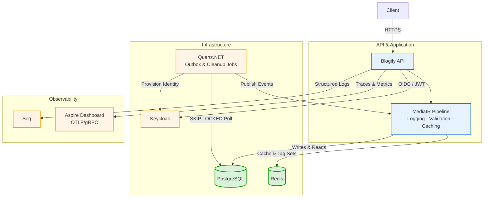

# Blogify API

A production-ready backend API for a modern blogging platform built with **.NET 11**, following **Clean Architecture**, **Domain-Driven Design (DDD)**, and **CQRS**.


## Table of Contents

- [Features](#-features)
- [Technology Stack](#%EF%B8%8F-technology-stack)
- [Architecture Overview](#%EF%B8%8F-architecture-overview)
- [Project Structure](#-project-structure)
- [Getting Started](#-getting-started)
- [API Overview](#-api-overview)
- [Production Configuration](#-production-configuration)
- [License](#-license)

## ✨ Features

- **Identity & Access Control (Keycloak OIDC):**
  - Asynchronous user provisioning via the Transactional Outbox Pattern with DataProtection-encrypted credential transit and automatic payload scrubbing.
  - Role-based (`Registered`, `Administrator`) and resource-ownership authorization (BOLA/IDOR protection on posts and comments, admin moderation support).
- **Content & Taxonomy Management:**
  - Full lifecycle management for **Posts** (`Draft`, `Published`, `Archived`), **Categories**, **Tags**, and **Comments**.
  - Public anonymous reads for published content; non-published posts (`Draft`/`Archived`) and their comments are restricted to their author and administrators.
  - Paginated list endpoints (`?page=1&pageSize=20`, capped at `100`) with `PagedResponse<T>` metadata and PostgreSQL `uuid[]` GIN-indexed taxonomy filtering.
- **Distributed Caching & Tag Invalidation:**
  - Redis-backed `ICacheService` with graceful degradation on cache outages and Redis-set tag invalidation (`cache-tag:*`) to evict related entries across posts, categories, and tags.
  - Cache eligibility gating prevents non-published posts from ever entering the shared cache.
- **Reliable Asynchronous Processing (Outbox Pattern):**
  - Quartz.NET workers using PostgreSQL `FOR UPDATE SKIP LOCKED`, worker leases (`locked_by`, `locked_until_utc`), exponential backoff, poison-message handling, `[JsonDerivedType]` polymorphic event allowlisting, and hourly retention cleanup (`OutboxCleanupJob`).
- **API Hardening & Resilience:**
  - Built-in ASP.NET Core Rate Limiting (`auth` IP-partitioned policy and `api` user/IP-partitioned policy) returning RFC 9457 `ProblemDetails` (`429`).
  - `Microsoft.Extensions.Http.Resilience` standard resilience pipelines for Keycloak communication with cached client-credentials admin tokens.
  - Reverse-proxy `ForwardedHeaders`, environment-aware CORS allowlisting, Brotli/Gzip response compression, and URL-segment API versioning (`/api/v1/...`).
- **Observability & Health Checks:**
  - OpenTelemetry distributed tracing & runtime/DB metrics exported via OTLP gRPC (Aspire Dashboard), structured logging via Serilog + Seq with correlation IDs and credential masking.
  - Separate `/health/live`, `/health/ready`, and `/health` probes for PostgreSQL, Redis, and Keycloak.

## 🛠️ Technology Stack

| Area | Technology / Library |
|---|---|
| **Runtime & Web** | .NET 11 (`net11.0`), ASP.NET Core 11 |
| **Architecture & Patterns** | Clean Architecture, DDD, CQRS (`MediatR 12.5`), Result Pattern |
| **Database** | PostgreSQL (`18.7`) with GIN indexes on `uuid[]` taxonomy columns |
| **ORM & Data Access** | Entity Framework Core `10.0`, `Npgsql.EntityFrameworkCore.PostgreSQL`, Dapper |
| **Authentication** | Keycloak (`26.0.7`, OAuth 2.0 / OIDC JWT Bearer), ASP.NET Core DataProtection |
| **Caching** | Redis (`8.10`) via `IDistributedCache` + `StackExchange.Redis` tag sets |
| **Resilience & Rate Limiting** | `Microsoft.Extensions.Http.Resilience`, `Microsoft.AspNetCore.RateLimiting` |
| **Validation** | FluentValidation |
| **Background Jobs** | Quartz.NET (`4.7`) |
| **API & Documentation** | `Asp.Versioning.Mvc`, `Microsoft.AspNetCore.OpenApi`, Scalar (`Scalar.AspNetCore`) |
| **Observability** | OpenTelemetry (OTLP), .NET Aspire Dashboard, Serilog, Seq |
| **Testing** | xUnit v3 (`Microsoft.Testing.Platform`), Shouldly, NSubstitute, NetArchTest, Testcontainers |

## 🏛️ Architecture Overview

Blogify enforces strict unidirectional dependencies using `NetArchTest.Rules`:

- **Domain:** Entities, Value Objects, Domain Events, Repository interfaces, and `Result`/`Error` primitives (zero external infrastructure dependencies).
- **Application:** CQRS Commands/Queries, FluentValidation validators, MediatR pipeline behaviors (`Logging`, `Validation`, `QueryCaching`, `CacheInvalidation`).
- **Infrastructure:** EF Core & Dapper persistence, PostgreSQL outbox & Quartz jobs, Redis caching & DataProtection key ring, Keycloak authentication/authorization handlers.
- **API (Presentation):** Versioned REST controllers, RFC 9457 `ProblemDetails` exception mapping, rate limiting, health probes, and OpenAPI/Scalar docs.



## 📁 Project Structure

```text
├── src/
│   ├── Blogify.Domain/          # Aggregates, Value Objects, Domain Events, Result/Error
│   ├── Blogify.Application/     # CQRS handlers, Validators, Pipeline Behaviors, Abstractions
│   ├── Blogify.Infrastructure/  # EF Core, Dapper, Outbox, Redis Cache, Keycloak, Quartz
│   └── Blogify.Api/             # Controllers, Middleware, Rate Limiting, OpenAPI/Scalar
├── test/
│   ├── Blogify.Domain.UnitTests/
│   ├── Blogify.Application.UnitTests/
│   ├── Blogify.Infrastructure.UnitTests/
│   ├── Blogify.ArchitectureTests/
│   └── Blogify.FunctionalTests/ # End-to-end tests backed by Testcontainers
├── docker-compose/              # Full local stack (API, Postgres, Redis, Keycloak, Seq, Aspire)
├── Directory.Build.props        # Shared target framework (net11.0) & test packages
├── Directory.Packages.props     # Central Package Management (CPM)
└── global.json                  # .NET 11 SDK & Microsoft.Testing.Platform config
```

## 🚀 Getting Started

### Prerequisites

- [.NET 11 SDK](https://dotnet.microsoft.com/) (`11.0.100+`)
- [Docker](https://www.docker.com/) & Docker Compose (for running the full stack and functional tests)

### Run Locally with Docker Compose

From the repository root:

```bash
docker compose -f docker-compose/docker-compose.yml up --build
```

The compose stack starts the API and all supporting infrastructure (including automatic EF Core migrations and pre-imported Keycloak realm in `Development`):

| Service | URL / Port | Purpose |
|---|---|---|
| **Blogify API** | `http://localhost:5000` | REST API |
| **Scalar API Reference** | `http://localhost:5000/scalar/v1` | Interactive API docs (`Development` only) |
| **OpenAPI Spec** | `http://localhost:5000/openapi/v1.json` | OpenAPI JSON document (`Development` only) |
| **Health Probes** | `/health`, `/health/live`, `/health/ready` | Liveness & dependency readiness |
| **Keycloak** | `http://localhost:18080` | Identity Provider (`admin` / `admin`) |
| **PostgreSQL** | `localhost:5454` | Primary database (`blogify`) |
| **Redis** | `localhost:6379` | Distributed cache & DataProtection key ring |
| **Seq** | `http://localhost:8082` | Structured log viewer |
| **Aspire Dashboard** | `http://localhost:18888` | OpenTelemetry traces & metrics |

### Running Tests

Run the entire solution test suite (unit, architecture, and Docker-backed functional tests):

```bash
dotnet test Blogify.slnx
```

> **Note:** `Blogify.FunctionalTests` spins up real PostgreSQL, Redis, and Keycloak containers via **Testcontainers**, so Docker must be running.

## 📡 API Overview

All endpoints are versioned under `/api/v1`:

| Resource | Public (`[AllowAnonymous]`) | Authenticated (`Registered`) | Admin Only (`Administrator`) |
|---|---|---|---|
| **Users** | `POST /users/register`, `POST /users/login` *(rate-limited)* | `GET /users/me` | — |
| **Posts** | `GET /posts`, `GET /posts/{id}`, `GET /posts/author/{id}`, `GET /posts/category/{id}`, `GET /posts/tag/{id}` *(Published only)* | `GET /posts/mine`, `POST /posts`, `PUT/DELETE /posts/{id}`, `PUT /posts/{id}/publish\|archive`, tags & categories *(Owner or Admin)* | Can modify/delete any post |
| **Comments** | `GET /comments/{id}`, `GET /comments/by-post/{postId}` *(Published posts only)* | `POST /comments`, `PUT /comments/{id}` *(Author only)*, `DELETE /comments/{id}` *(Author or Admin)* | Can delete any comment |
| **Categories** | `GET /categories`, `GET /categories/{id}`, `GET /categories/with-post-count` | — | `POST`, `PUT`, `DELETE` |
| **Tags** | `GET /tags`, `GET /tags/{id}` | — | `POST`, `PUT`, `DELETE` |

List endpoints accept `?page=1&pageSize=20` (`pageSize` capped at `100`) and return:

```json
{
  "items": [],
  "page": 1,
  "pageSize": 20,
  "totalCount": 0,
  "totalPages": 0,
  "hasNextPage": false,
  "hasPreviousPage": false
}
```


## 🔐 Production Configuration

`appsettings.Production.json` disables automatic startup migrations and enforces HTTPS metadata by default. Before deploying to production, configure the following via environment variables or a secret store:

- **Connection Strings:** `ConnectionStrings__Database`, `ConnectionStrings__Cache`
- **Keycloak & JWT:** `Authentication__Issuer`, `Authentication__MetadataUrl`, `Authentication__Audience`, `Keycloak__BaseUrl`, `Keycloak__AdminUrl`, `Keycloak__TokenUrl`, `Keycloak__AdminClientId`, `Keycloak__AdminClientSecret`, `Keycloak__AuthClientId`, `Keycloak__AuthClientSecret`
- **CORS:** `Cors__AllowedOrigins__0=https://your-frontend.example` (empty array rejects cross-origin requests outside `Development`)
- **Reverse Proxy:** `ForwardedHeaders__KnownProxies__0` / `KnownNetworks__0` (required behind Nginx/Traefik/Cloudflare/ALB so IP-based rate limiting and scheme detection see the real client IP)
- **Database Migrations:** Apply EF Core migrations explicitly in your CI/CD pipeline (`dotnet ef database update`) prior to starting application instances.
- **Bootstrap Admin:** Assign the seeded `Administrator` role (`roles_id = 2`) in `role_user` to your initial admin account.

## 📄 License

This project is licensed under the **MIT License** — see the [LICENSE](LICENSE) file for details.